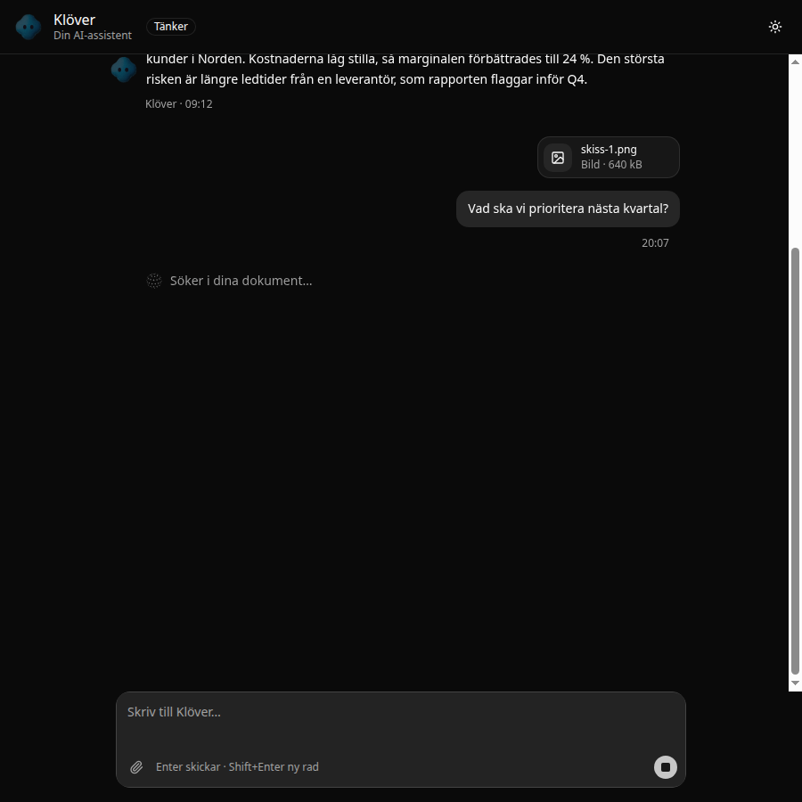
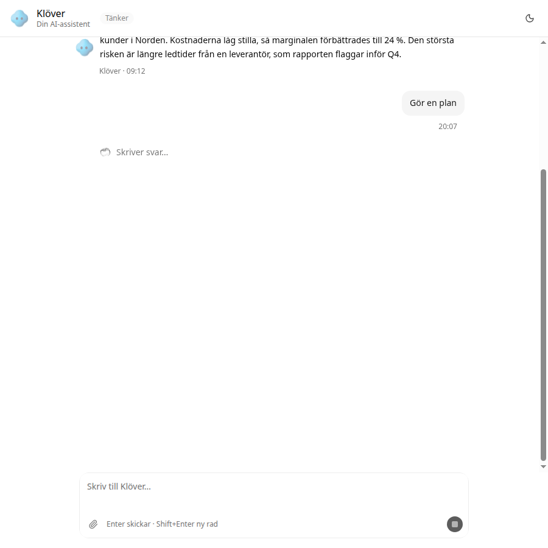

# Agent Status (egen)

> En statusrad som visar vad en AI-agent gör just nu: en Thinking Orb och en skimrande etikett, t.ex. "Söker i dina dokument…".

| | |
|---|---|
| **Kategori** | AI-UI · Loaders · **Egen komponent** |
| **Källa** | Byggd med skillen `shadcn-component-design`, demo i `demos/ai-chat/` |
| **Licens** | Vår egen, fri att använda |
| **Teknik** | React, shadcn/ui (base-nova), Thinking Orbs |
| **Bygger på** | `ThinkingOrb` från designbiblioteket och shadcn:s `shimmer`-verktyg |
| **Tillagd** | 2026-10-11 |



## Varför jag gillar den

<Fyll i.>

## Designprinciper

- **Visa vad, inte bara att.** Varje steg har en egen orb-animation och en egen text, så användaren ser *vad* agenten gör, t.ex. söker, analyserar eller skriver.
- **Två signaler som förstärker varandra.** Orben ger rörelse och skimret visar att texten är tillfällig. Båda är diskreta och monokroma.
- **Tillgänglig.** `role="status"` med `aria-live="polite"` gör att skärmläsare läser upp varje nytt steg. Orben är `aria-hidden`, eftersom texten redan säger samma sak.
- **Respekterar reducerad rörelse.** Orben visar en stillbild, och skimret stängs av med `motion-reduce:shimmer-none`.

## Användning

Kopiera `agent-status.tsx` till `components/ui/`. Den kräver `thinking-orb.tsx` från `design-library/elements/thinking-orbs/` och `npm install thinking-orbs`. Shimmer-verktyget kommer från `shadcn/tailwind.css`, som finns i alla nya shadcn-projekt.

```tsx
<AgentStatus state="searching">Söker i dina dokument…</AgentStatus>
<AgentStatus state="solving">Analyserar…</AgentStatus>
<AgentStatus state="composing" />   {/* standardtext: "Writing…" */}
```

`state`: `working`, `searching`, `solving`, `listening`, `connecting`, `weaving`, `composing`, `breathing` (standard, "Thinking…") eller `shaping`.

Ett tips från demon är att låta agentens faktiska steg styra `state`, så att indikatorn betyder något:

```tsx
const STEPS = [["searching", "Söker…"], ["solving", "Analyserar…"], ["composing", "Skriver svar…"]]
```

## Anteckningar

- Testad i `demos/ai-chat/`, ljust och mörkt tema.
- Standardtexterna är på engelska, som i shadcn. Skicka in svensk text som barn.


