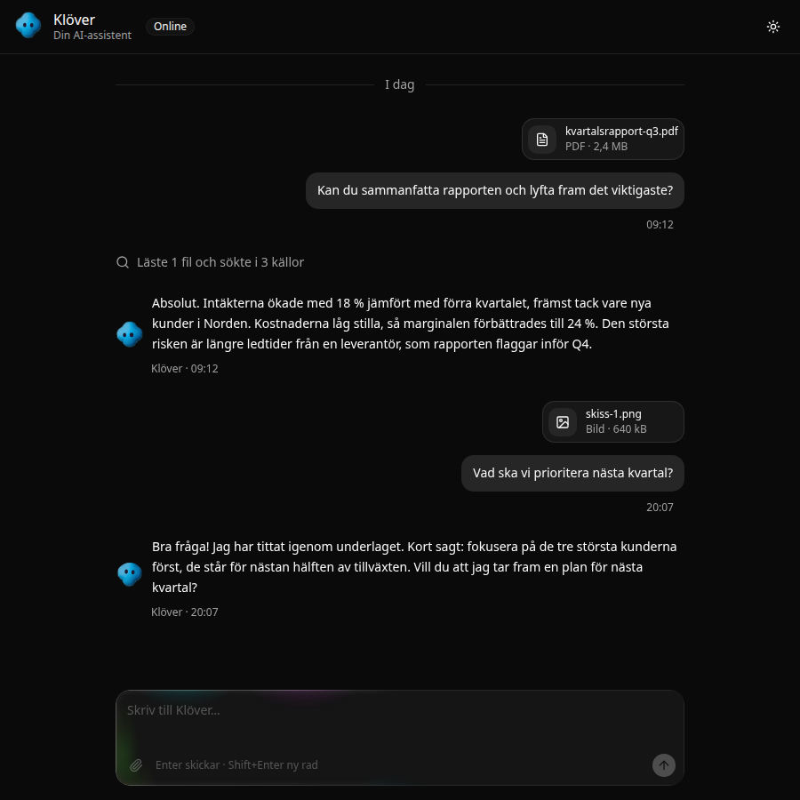

# Prompt Input (egen)

> Skrivfältet i ett AI-chattgränssnitt: textfält, bilagor, verktyg och en skickaknapp som blir stopp medan agenten svarar.

| | |
|---|---|
| **Kategori** | AI-UI · Formulär · **Egen komponent** |
| **Källa** | Byggd med skillen `shadcn-component-design`, demo i `demos/ai-chat/` |
| **Licens** | Vår egen, fri att använda |
| **Teknik** | React, shadcn/ui (base-nova) |
| **Bygger på** | shadcn:s `InputGroup`, `Textarea` och `Button` |
| **Tillagd** | 2026-10-11 |



## Varför jag gillar den

<Fyll i.>

## Designprinciper

- **Bygger på befintliga shadcn-delar.** Fokusring, felläge, disabled och mörkt tema kommer gratis från `InputGroup` och ser därför ut som alla andra fält i appen.
- **En knapp, två roller.** Skicka blir stopp medan agenten arbetar (`status="submitted" | "streaming"`). Användaren behöver aldrig leta efter avbryt.
- **Tangentbordet först.** Enter skickar och Shift+Enter ger ny rad. Inget skickas medan en IME (t.ex. japanska eller kinesiska tecken) håller på att skriva.
- **Fria platser för innehåll.** `PromptInputAttachments` överst och `PromptInputTools` nederst tar vad som helst, t.ex. shadcn:s `Attachment` eller egna knappar.
- **Status som data-attribut.** `data-status` på roten och på knappen gör att du kan styla från omgivningen, t.ex. `group-data-[status=streaming]/prompt-input:…`.

## Delar

| Del | Vad |
|---|---|
| `PromptInput` | Roten, ett `<form>`. Props: `status` (`idle`, `submitted`, `streaming`, `error`), `onStop` och vanliga form-props som `onSubmit`. |
| `PromptInputTextarea` | Textfältet. Sköter Enter och Shift+Enter. |
| `PromptInputAttachments` | Bilagor ovanför textfältet. Döljs när den är tom. |
| `PromptInputFooter` | Nedre raden. |
| `PromptInputTools` | Plats för verktygsknappar till vänster. |
| `PromptInputSubmit` | Skicka/stopp. Visar en pil eller en stoppikon och har en `aria-label` som följer läget. |

## Användning

Kopiera `prompt-input.tsx` till `components/ui/`. Den kräver shadcn:s `button` och `input-group`:

```bash
npx shadcn@latest add button input-group
```

```tsx
<PromptInput status={status} onStop={stop} onSubmit={send}>
  <PromptInputAttachments>
    <AttachmentGroup>{/* Attachment … */}</AttachmentGroup>
  </PromptInputAttachments>
  <PromptInputTextarea value={draft} onChange={(e) => setDraft(e.target.value)} placeholder="Skriv…" />
  <PromptInputFooter>
    <PromptInputTools>
      <Button type="button" variant="ghost" size="icon-sm" aria-label="Bifoga fil"><PaperclipIcon /></Button>
    </PromptInputTools>
    <PromptInputSubmit disabled={!draft.trim()} />
  </PromptInputFooter>
</PromptInput>
```

Låt en glöd synas medan agenten arbetar genom att lägga den i Border Beam:

```tsx
<BorderBeam active={status !== "idle"} className="rounded-xl">
  <PromptInput …>…</PromptInput>
</BorderBeam>
```

## Anteckningar

- Testad i `demos/ai-chat/` (headless Chrome, ljust och mörkt tema, helt flöde med bilaga och stopp). TypeScript-typerna är inte kontrollerade med `tsc`, eftersom Node saknades.
- Idéer: en `PromptInputModelSelect` med shadcn:s `Select`, och dra-och-släpp för bilagor.


